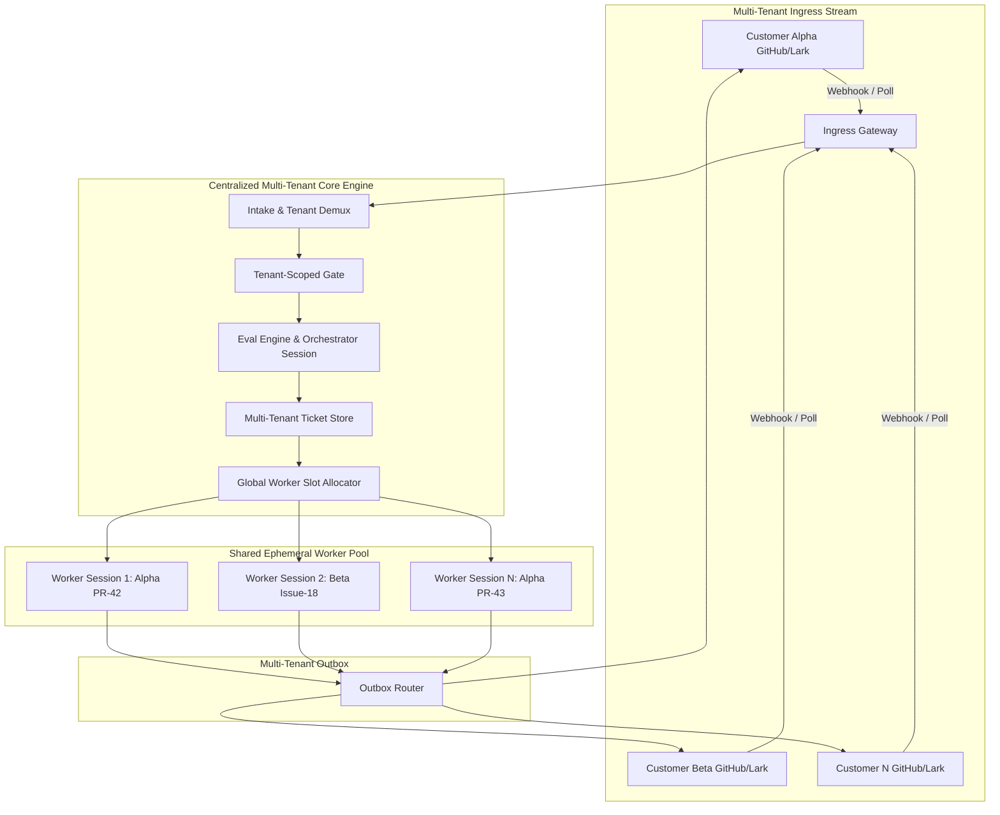
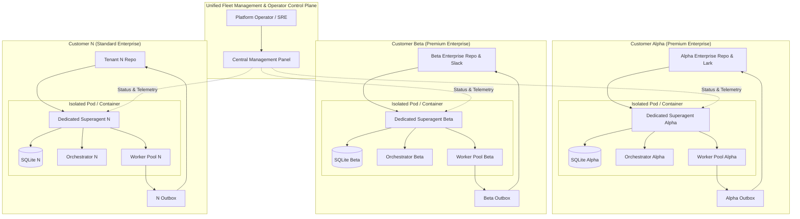
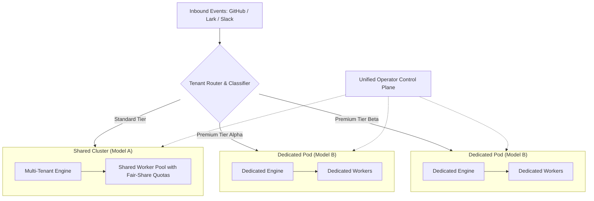

# 01. Enterprise Tenancy Models

This document specifies the architectural patterns for deploying **dsh-superagent** across hundreds of enterprise customers. It builds directly upon [001 Domain model](../docs/001-domain.md), [002 Authorization](../docs/002-authorization.md), [003 Execution](../docs/003-execution.md), and [007 Architecture](../docs/007-architecture.md).

---

## 1. The Multi-Customer Landscape

In a single-team deployment, dsh-superagent acts as a single automated colleague: it connects to one GitHub repository, optionally one Feishu/Lark bot, and executes under the operator's local OS environment.

When serving **hundreds of enterprise customers**, the system must fulfill fundamentally different operational constraints:

```
┌────────────────────────────────────────────────────────────────────────┐
│                        Enterprise Customer Base                        │
│                                                                        │
│   [ Customer Alpha ]         [ Customer Beta ]     ... [ Customer Omega ]
│   - GitHub Org: alpha-corp   - GitHub Org: beta-inc    - Private GitLab
│   - Lark Suite: Alpha Org    - Slack Workspace         - Custom Webhook
│   - Dedicated Bot Identity   - Shared Bot Identity     - Air-gapped VPC
│   - Custom Policies & Rules  - Strict Compliance SLA   - High Concurrency
└───────────────────────────────────┬────────────────────────────────────┘
                                    │
                                    ▼
┌────────────────────────────────────────────────────────────────────────┐
│                     dsh-superagent Platform Core                       │
│        (Intake ──► Gate ──► Eval ──► Ticket ──► Executor ──► Outbox)   │
└────────────────────────────────────────────────────────────────────────┘
```

Three core architectural archetypes address this scaling challenge:
1. **Model A: Centralized Shared Multi-Tenant Superagent** (One Agent Pool for All Customers)
2. **Model B: Siloed Dedicated Superagent per Customer** (Autonomous Instance per Enterprise Tenant / Premium Tier)
3. **Model C: Hybrid Tiered Architecture** (Shared Ingress & Triage Gateway + Customer-Isolated Execution Pods)

---

## 2. Model A: Centralized Shared Multi-Tenant Superagent

### 2.1 Overview & Topology
In Model A, a single centralized dsh-superagent platform (or a horizontally autoscaled stateless cluster of platform engines) ingests events from all 100+ enterprise customer sources. It processes intake, runs evaluations, manages tickets, and dispatches worker sessions from a centralized pool.



### 2.2 Stateless & Session-Isolated Mechanics
To make Model A viable across hundreds of customers:
1. **Tenant Demultiplexing at Intake:** Every incoming `Trigger` is tagged with a deterministic `tenantId` (e.g., derived from the GitHub repository owner or Feishu tenant key).
2. **Deterministic Gate Scoping:** The `Policy.gate` verifies the actor's identity against the specific tenant's allowed list (`Policy[tenantId].allowed`).
3. **Logical Ticket Partitioning:** A single unified database maintains all Tickets, indexed by `tenantId`. A Ticket's execution environment is strictly isolated to its designated tenant worktree directory:
   ```
   <stateDir>/work/<tenantId>/<ticketShortName>/
   ```
4. **Credential Isolation via Environment Shims:** Worker sessions execute commands using dynamic, scoped CLI wrappers (e.g., dynamically injecting GitHub Installation Access Tokens restricted exclusively to `alpha-corp/repo-a`).
5. **Session Isolation:** The Orchestrator Session handles evaluation in a stateless or ephemeral context, ensuring that context from Customer Alpha is never leaked into the prompt history of Customer Beta.

### 2.3 Domain Entity Mapping for Model A

| Core Concept | Single-Tenant Behavior | Model A (Shared Multi-Tenant) Extension |
|---|---|---|
| **Source** | Watches one repository and one bot. | Multi-Source Registry managing hundreds of tenant source bindings: `{tenantId, sourceKind, config}`. |
| **Trigger** | Unique event id hashed from payload. | Keyed by `{tenantId, triggerId}`. Cross-tenant event replay is mathematically impossible. |
| **Thread** | Thread key (e.g., `github:12`). | Namespaced: `tenant:<tenantId>:github:12`. Subscriptions are strictly isolated to their tenant namespace. |
| **Policy** | Single versioned rule set and allowed list. | Multi-Tenant Policy Map: `PolicyRegistry.get(tenantId, version)`. Tenant policies evolve independently. |
| **Eval & Mandate** | Evaluates triggers on a thread. | Evaluates within tenant thread bounds. The `Mandate` records `tenantId`, guaranteeing that authorized scope cannot cross tenant borders. |
| **Ticket & Assignment** | Unit of work executed in `<stateDir>/work`. | Scoped to tenant directory `<stateDir>/work/<tenantId>/<ticket>`. Cleanup guarantees deletion after ticket lifecycle ends. |
| **Executor** | Pool of `workerSlots` on the host machine. | Fair-share Worker Allocator with per-tenant concurrency quotas (e.g., max 2 concurrent workers per tenant). |

---

## 3. Model B: Siloed Dedicated Superagent per Enterprise Customer

### 3.1 Overview & Topology
In Model B, each enterprise customer receives a dedicated, self-contained **Superagent Instance** (e.g., deployed in a dedicated Docker container, Kubernetes Pod, or isolated VM). This pattern is designed for **Premium / Tier-1 Enterprise Customers** requiring absolute security, custom integrations, and zero resource contention.



### 3.2 Infrastructure & Security Isolation
1. **OS & Kernel Boundaries:** Each enterprise superagent runs in its own container or virtual machine. There is zero shared memory, zero shared disk, and no cross-process communication between customers.
2. **Dedicated Credential Enclaves:** Customer Alpha's GitHub App private keys, personal access tokens, and Lark bot secrets reside in a dedicated secret store / volume mounted exclusively to Pod Alpha.
3. **Dedicated State & SQLite Stores:** Each instance maintains its own `<stateDir>` and SQLite database. Customer data never mingles at rest.
4. **Dedicated Model Provider Quotas:** Customer Alpha can provide their own enterprise Azure OpenAI / Vertex AI / DeepSeek API endpoints and keys. Token rate limits (TPM/RPM) are isolated to that specific customer.
5. **Custom System Tools & Execution Environments:** An enterprise customer requiring custom binaries (e.g., internal build tools, proprietary compilers, specific Node/Python versions) has a tailored container image without affecting other tenants.

---

## 4. Model C: The Hybrid Tiered Architecture

### 4.1 Overview & Architecture
To achieve optimal unit economics while satisfying high-security enterprise requirements, Model C combines the best attributes of Models A and B:
- **Standard Customers (Tier 2 / Free / Trial):** Run on a Centralized Shared Superagent Cluster (Model A), maximizing compute utilization and minimizing idle costs.
- **Premium Enterprise Customers (Tier 1 / VIP / Regulated):** Run on Dedicated Superagent Pods (Model B), backed by enterprise SLAs, private VPC peering, and custom policies.
- **Universal Ingress & Fleet Control Plane:** A shared ingress routing plane directs traffic to the appropriate instance, while the platform operator monitors everything through a single unified interface.



---

## 5. Domain Invariant Preservation

Regardless of whether Model A, Model B, or Model C is deployed, the dsh-superagent core domain invariants must never be violated:

1. **The Attention Invariant:** The agent speaks only when a human must act (an `Attention` question) or when a reviewable artifact is ready (`ready` report / Pull Request). Multi-tenancy must not introduce broadcast alert chatter.
2. **The Gate Invariant:** Deterministic admission (`policy.gate`) precedes model evaluation. Unauthenticated or unlisted actors from any customer are rejected before calling any LLM API, preventing prompt-injection attacks and unbilled token consumption.
3. **The Mandate Invariant:** A worker cannot execute work without a cryptographic, versioned `Mandate`. In multi-tenant environments, the Mandate explicitly binds the execution to the customer's tenant identity and authorized scope.
4. **The Ticket Invariant:** Ticket state transitions (`working`, `idle`, `person / answer`, `person / review`, `ended`) remain completely decoupled from the underlying hosting infrastructure.
