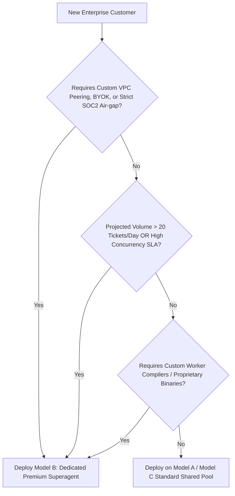

# 02. Multi-Customer Trade-Off Analysis

This document provides a rigorous trade-off analysis comparing the deployment archetypes for **dsh-superagent** across hundreds of enterprise customers:
- **Model A:** Centralized Shared Multi-Tenant Superagent (One Agent Pool for All)
- **Model B:** Siloed Dedicated Superagent per Customer (Dedicated Instance / Premium Tier)
- **Model C:** Hybrid Tiered Architecture (Multi-Tenant Ingress + Dedicated Execution Sandboxes)

---

## 1. Comprehensive Trade-Off Matrix

| Evaluation Dimension | Model A: Centralized Shared Pool | Model B: Dedicated Superagent | Model C: Hybrid Tiered Architecture |
|---|---|---|---|
| **1. Data Isolation & Security** | ⚠️ **Logical Isolation Only.** Vulnerable to OS-level leakage, file permission errors, or cross-tenant contamination in shared memory. | 🟢 **Absolute Hardware/Kernel Isolation.** Dedicated container/VM, isolated disk, isolated secrets, zero cross-tenant contamination. | 🟢 **High Isolation.** Ephemeral sandboxed worker execution per tenant; shared ingress gateway has no access to customer disk or code. |
| **2. Concurrency & Noisy Neighbors** | 🔴 **High Contention Risk.** One customer bursting 50 PRs can exhaust global worker slots and trigger rate limits, starving other clients. | 🟢 **Zero Cross-Tenant Contention.** Each customer has dedicated CPU, RAM, and worker slot quotas. Contention is purely internal to the tenant. | 🟢 **Controlled Contention.** Central admission queue with per-tenant rate limiters and dedicated or autoscaled worker pods. |
| **3. LLM API Rate Limits & Quotas** | 🔴 **Shared Quota Bottleneck.** Shared API key hits provider TPM/RPM limits. A rogue tenant exhausts rate limits for all 100 customers. | 🟢 **Isolated Provider Quotas.** Supports Bring-Your-Own-Key (BYOK). Rate limits on Tenant A have zero impact on Tenant B. | 🟢 **Flexible Quotas.** BYOK for Premium tenants; pooled enterprise quota with token budgeting for Standard tenants. |
| **4. Operational & SRE Complexity** | 🟢 **Lowest SRE Footprint.** Single service to deploy, monitor, upgrade, and maintain. Database migrations run once globally. | 🔴 **High SRE Overhead.** Managing 100+ running instances, 100+ SQLite databases, independent upgrade rollouts, and health checks. | 🟡 **Moderate SRE Overhead.** Managed Kubernetes cluster with GitOps/CRD operator managing tenant workers dynamically. |
| **5. Customization & Autonomy** | 🔴 **Limited Customization.** Global prompt templates; restricted shell tools to prevent host compromise; standard worker images only. | 🟢 **Maximum Customization.** Custom worker Dockerfiles, bespoke proprietary compilers, custom enterprise prompts, custom VPN/VPC peering. | 🟢 **Tiered Customization.** Standard tenants use base templates; Premium tenants configure custom worker images and prompt extensions. |
| **6. Onboarding & Provisioning Time** | 🟢 **Instant (Seconds).** New customer configures webhook/GitHub App; tenant record created in database; ready immediately. | 🔴 **Slower (Minutes/Hours).** Requires container provisioning, DNS setup, volume creation, and health check validation. | 🟡 **Fast (Under 1 minute).** Tenant metadata provisioned instantly; worker runtime spawned on demand. |
| **7. Blast Radius & Fault Tolerance** | 🔴 **Catastrophic Blast Radius.** A fatal bug, OOM crash, or runtime lockup halts service for all 100 enterprise customers simultaneously. | 🟢 **Isolated Blast Radius.** A crash, corrupt repo, or hung job in Tenant Alpha impacts only Tenant Alpha. Other 99 tenants run unaffected. | 🟢 **Narrow Blast Radius.** Worker pod crashes affect only that specific ticket; gateway has high availability redundancy. |
| **8. Infrastructure Cost (Idle vs Active)** | 🟢 **Optimal Unit Economics.** Minimal idle compute. Resources scaled dynamically based on aggregate load across all tenants. | 🔴 **High Idle Cost.** 100 continuously running pods/VMs consume base memory, CPU, and disk even when inactive overnight. | 🟢 **Cost Efficient.** Shared gateway remains warm; worker execution pods scale to zero when idle. |

---

## 2. In-Depth Dimension Deep Dives

### 2.1 Security, Isolation & Enterprise Compliance
Enterprise clients in finance, healthcare, and enterprise software require verifiable compliance standards (SOC 2 Type II, ISO 27001, HIPAA, GDPR):

#### In Model A (Shared):
- dsh-superagent by default runs with `danger-full-access` as the host OS user (`docs/006-deployment.md`).
- If 100 customers share the same OS user, a malicious or prompt-injected worker in Customer A could theoretically execute:
  ```bash
  cat /stateDir/work/customer-b/secret.env
  cat ~/.config/gh-agent/hosts.yml
  ```
- **Verdict:** Model A requires comprehensive sandboxing (e.g., gVisor, Firecracker microVMs, or rootless Linux containers per ticket). Plain directory partitioning is unacceptable for enterprise risk.

#### In Model B (Dedicated):
- Each customer instance runs in a hardened Kubernetes Pod or VM within a dedicated Kubernetes namespace or VPC.
- The agent holds only Customer Alpha's credentials. Customer Alpha's data is encrypted at rest using Customer Alpha's KMS key.
- **Verdict:** Readily passes SOC 2 and ISO 27001 audits without complex runtime sandbox engineering.

---

### 2.2 Concurrency, Worker Slots & The Noisy Neighbor Problem

In dsh-superagent, worker execution is strictly bounded:
```ts
// src/deployment.ts & docs/003-execution.md
concurrency: number // e.g. 4 worker slots + 1 human-priority slot
```

```
Scenario: 100 Enterprise Customers on a Shared 16-Slot Machine (Model A)
- Customer 1 merges a large PR triggering 10 CI failure tickets.
- Customer 2 opens an automated dependency upgrade of 15 packages.
- Total worker slots demanded: 25.
- Result: Global queue full.
- Customer 3's CTO comments "@superagent urgent hotfix for production outage".
- Concurrency limit reached: Customer 3's urgent ticket waits in `working / queued`.
```

#### Mitigation in Model B:
- Customer 1's bursts are constrained to Customer 1's dedicated 4 slots.
- Customer 3's dedicated agent immediately picks up the urgent hotfix ticket in its dedicated slot.
- Internal contention is resolved by dsh-superagent's built-in priority rule (human wake bypasses normal slots).

#### Mitigation in Model C:
- Shared ingress implements **Fair-Share Weighted Round-Robin (WRR)** queuing per tenant.
- When an urgent human request arrives, a dynamic worker container is spun up specifically for that customer within seconds.

---

### 2.3 LLM Costs, Quotas & Token Attribution

AI agents consume massive token volumes through reasoning loops, large diff evaluations, and tool invocations.

1. **Token Attribution & Chargeback:**
   - In Model A, a shared API key requires the platform core to record token counts per `tenantId` in the SQLite `tickets` table and reconcile against billing systems.
   - In Model B, each enterprise customer can supply their own enterprise Azure OpenAI / Bedrock / Vertex AI endpoint and key. The customer pays the model provider directly, eliminating token resale margins, billing reconciliation risks, and financial liability.
2. **Rate Limit Isolation (TPM / RPM):**
   - Major LLM providers enforce strict Tier limits (e.g., 200k Tokens Per Minute).
   - In Model A, if Customer A's worker dumps a 50,000-token repository trace into context, it triggers a `429 Too Many Requests` error that freezes evaluations for Customers B, C, and D.
   - In Model B, 429 errors are completely isolated to the triggering customer.

---

### 2.4 Operational Complexity & SRE Overhead

| SRE Task | Model A (Centralized Shared) | Model B (Dedicated per Customer) |
|---|---|---|
| **Deploying Code Updates** | Run `git pull && pnpm build && dsh restart` once. | Rolling update across 100+ containers. Needs automated GitOps pipeline (ArgoCD / Helm). |
| **Database Migrations** | Migrate 1 SQLite/Postgres database. | Run migration script over 100+ separate SQLite databases. Requires rollback safety. |
| **Log Aggregation & Monitoring** | Monitor 1 process, 1 log stream, 1 health status. | Fleet monitoring: Central OpenTelemetry / Prometheus collector scraping 100+ targets. |
| **Operator Intervention** | Operator checks 1 Superagent Web Panel. | Operator must switch between 100 panels unless a Fleet Control Plane is built. |

**Key Takeaway for SREs:**
Model A is dramatically easier to maintain for a solo engineer or small team. Model B requires a mature Kubernetes / Container platform with automated provisioning, centralized observability, and declarative configuration.

---

## 3. Total Cost of Ownership (TCO) Comparison

Assuming an infrastructure baseline of **100 enterprise customers** where:
- 80 customers have low/moderate activity (1-5 tickets/day).
- 20 customers have high activity (15-40 tickets/day).

```
Model A (Shared Cluster):
- 2x High-Spec Compute Instances (e.g., 32 vCPU, 64 GB RAM): ~$800/month
- Centralized Database & Egress: ~$200/month
- Total Infrastructure Cost: ~$1,000/month (excluding LLM tokens)
- Average Infra Cost per Customer: $10/month

Model B (Dedicated Pods):
- 100x Pods (minimum 1 vCPU, 2 GB RAM per pod to avoid OOM during node/git work):
  Total: 100 vCPU, 200 GB RAM baseline.
- Kubernetes Cluster Cost (EKS/GKE with autoscaling): ~$3,500 - $4,800/month
- Total Infrastructure Cost: ~$4,000/month
- Average Infra Cost per Customer: $40/month

Model C (Hybrid Tiered):
- 1x Central Ingress Gateway (4 vCPU, 8 GB RAM): ~$150/month
- 20x Dedicated Pods for High-Tier/VIP customers: ~$800/month
- Ephemeral Serverless/K8s Job Worker Pool for Standard customers: ~$600/month
- Total Infrastructure Cost: ~$1,550/month
- Blended Infra Cost per Customer: $15.50/month
```

---

## 4. The Enterprise Decision Framework

Use this deterministic rubric to assign customer organizations to the correct architectural tier:



### Strategic Recommendation

1. **Do not attempt Model A without OS Sandboxing:** If deploying Model A, workers must run in lightweight isolated containers (e.g., Docker-out-of-Docker or Kubernetes Jobs), not as the host OS user.
2. **Adopt Model C as the Ultimate Target:** Use a unified ingress gateway for webhook reception and policy gating, but execute worker sessions in isolated tenant pods that scale to zero when idle.
3. **Offer Model B as the "Enterprise White-Glove" SKU:** Charge enterprise customers a premium license fee that covers the dedicated infrastructure cost, dedicated model quota, and custom SLA.
