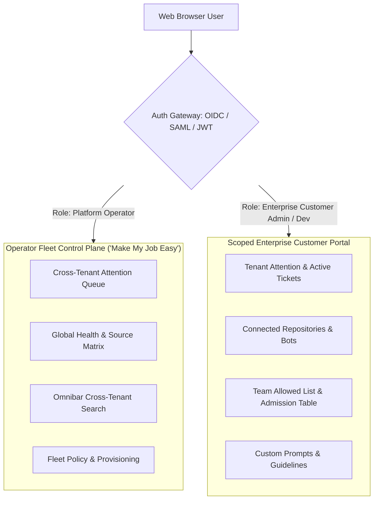

# 03. Enterprise Panel & UI Specification

This document specifies the user interface architecture for deploying **dsh-superagent** across hundreds of enterprise customers. It directly addresses the operator requirement: **"How can the user interface act on this and make my job easy?"**

It builds on [000 Philosophy](../docs/000-philosophy.md), [005 Panel](../docs/005-panel.md), and [01. Enterprise Tenancy Models](01-enterprise-tenancy-models.md).

---

## 1. The Core UI Dilemma

In the existing single-tenant prototype, the Web Panel (`src/client/`, `src/app/http.ts`) runs on loopback `127.0.0.1:<port>` for a single operator managing a single repository.

When serving **hundreds of enterprise customers**, two conflicting needs arise:
1. **The Operator Need ("Make My Job Easy"):** The platform operator cannot manually log in to 100 separate browser tabs or localhost ports. They need a single dashboard that instantly surfaces what is broken, what requires intervention across any tenant, and how resources are performing.
2. **The Enterprise Customer Need:** Enterprise administrators and developers need visibility into their own agent's tickets, PR reviews, and attention questions without ever seeing another customer's code, issues, or configuration.

---

## 2. Dual-Persona UI Architecture

The platform splits the user interface into two coordinated personas backed by Role-Based Access Control (RBAC):



---

## 3. Persona 1: The Operator Fleet Control Plane ("Make My Job Easy")

The Operator Control Plane is designed strictly according to dsh-superagent's **Three Questions**, scaled to 100+ enterprise tenants:

### 3.1 The 3 Questions at Fleet Scale

1. **Does anything across all 100+ customers need me right now?**
   - **Cross-Tenant Attention Queue:** Consolidates every ticket currently in `person / answer` (worker has an unanswered question), `person / delivery` (input delivery failed), or `person / blocked, failed` across all tenants.
   - **Setup & Outage Alerts:** Highlights any customer whose GitHub CLI token expired, Lark bot webhook failed, or rate limit exceeded.
   - If nothing is blocked or broken, this screen is completely blank and quiet.

2. **Is the fleet healthy and doing the right things?**
   - **Source Matrix:** Instant green/amber/red status of all customer GitHub and Lark integrations.
   - **Global Concurrency & Capacity Meter:** Real-time worker slot utilization across dedicated pods and shared clusters.
   - **LLM Rate-Limit Warnings:** Early alerts when a customer or shared pool reaches 80% of provider TPM/RPM quotas.

3. **What is the history of any customer's ticket?**
   - **Cross-Tenant Omnibar Search:** Search by `#123`, commit hash, customer name, GitHub URL, or ticket ID across all enterprise tenants in milliseconds.

### 3.2 Operator Control Plane Wireframe

```
┌──────────────────────────────────────────────────────────────────────────────────────────────────┐
│  dsh-superagent FLEET CONTROL PLANE        [Search: tenant, PR #, or commit...  ]  (Operator: Alice)│
├──────────────────────────────────────────────────────────────────────────────────────────────────┤
│  [!] ATTENTION REQUIRED ACROSS FLEET (3 items waiting)                                           │
│  ┌───────────────┬────────────┬─────────────────────────────┬─────────────────────┬────────────┐ │
│  │ Tenant        │ Ticket     │ Stage                       │ Waiting Question/Err│ Action     │ │
│  ├───────────────┼────────────┼─────────────────────────────┼─────────────────────┼────────────┤ │
│  │ Acme-Bank     │ #T-1049    │ Blocked (CI test timeout)   │ Build script hung   │ [Retry]    │ │
│  │ HealthCorp    │ #T-1052    │ Attention (Schema decision) │ "Drop legacy column?│ [View PR]  │ │
│  │ FinTech-Pro   │ Source     │ GitHub Token Expired        │ BadCredentials 401  │ [Fix Auth] │ │
│  └───────────────┴────────────┴─────────────────────────────┴─────────────────────┴────────────┘ │
├──────────────────────────────────────────────────────────────────────────────────────────────────┤
│  FLEET HEALTH SUMMARY (104 Enterprise Tenants)                                                   │
│  - Active Workers: 28 / 64 slots       - Ingress Rate: 42 triggers/min                           │
│  - Healthy Sources: 102 / 104          - 24h Completed Tickets: 312                              │
├──────────────────────────────────────────────────────────────────────────────────────────────────┤
│  TENANT FLEET BROWSER                                                                            │
│  [ Filter: All Tiers ▼ ] [ Sort: Recent Activity ▼ ]                                              │
│  • Acme-Bank (Tier 1 Dedicated)     - 3 active tickets, Health: 100%, LLM: 14% quota             │
│  • HealthCorp (Tier 1 Dedicated)    - 1 active ticket,  Health: 100%, LLM: 8% quota              │
│  • Retail-Corp (Tier 2 Shared)      - 0 active tickets, Health: 100%, LLM: 2% quota              │
│  • FinTech-Pro (Tier 1 Dedicated)   - 0 active tickets, Health: DEGRADED (Auth error)            │
└──────────────────────────────────────────────────────────────────────────────────────────────────┘
```

---

## 4. Persona 2: The Enterprise Customer Portal

Each enterprise customer receives access to a scoped, branded portal accessible via their corporate Single Sign-On (Okta, Azure AD, PingFederate, Google Workspace).

### 4.1 Scoped Capabilities

| Tab | What the Enterprise Customer Sees & Controls | What is Hidden / Locked |
|---|---|---|
| **Overview** | Their organization's active tickets, PRs awaiting review, and attention questions. | Other tenants' data; global server resource stats. |
| **Tickets & History** | Full audit trail of all their tickets, worker logs, git branches, and LLM reasoning steps. | Underlying host OS paths or host server configurations. |
| **Policy & Team** | Manage who in their GitHub org or Feishu chat is on the `allowed` list to invoke the agent. | Global system admission rules. |
| **Prompts & Rules** | Edit team prompt sections (`team/communication.md`, `team/delivery.md`) to instruct the agent on their coding conventions. | Core system prompt sections (`dispatch.md`, `admission.md`). |
| **Settings** | Repository connection settings, branch protection rules, auto-merge permissions. | Server `stateDir`, machine memory limits, host CLI shims. |

### 4.2 Customer Portal Wireframe

```
┌──────────────────────────────────────────────────────────────────────────────────────────────────┐
│  Acme-Bank AI Assistant Portal              [Search Acme Tickets...]          (User: Bob - Admin)│
├──────────────────────────────────────────────────────────────────────────────────────────────────┤
│  ACTIVE WORK (2 Tickets)                                                                         │
│  ┌────────────┬─────────────────────────────┬──────────────────────────┬───────────────────────┐ │
│  │ Ticket     │ Stage                       │ Summary                  │ Review / Action       │ │
│  ├────────────┼─────────────────────────────┼──────────────────────────┼───────────────────────┤ │
│  │ #T-1048    │ Awaiting Review             │ Refactor Auth Middleware │ [Review PR #204 on GH]│ │
│  │ #T-1050    │ Working                     │ Fix Redis Connection Leak│ Progress: 80% (Pass 4)│ │
│  └────────────┴─────────────────────────────┴──────────────────────────┴───────────────────────┘ │
├──────────────────────────────────────────────────────────────────────────────────────────────────┤
│  TEAM PERMISSIONS & ALLOWED LIST                                                                 │
│  Allowed Requester Logins:                                                                       │
│  [ @bob-lead, @alice-dev, @charlie-qa, @security-bot ]                          [ + Add Member ] │
│                                                                                                  │
│  Admission Mode: [ Auto-Accept Inferred Work (Observed & Filtered) ▼ ]                           │
├──────────────────────────────────────────────────────────────────────────────────────────────────┤
│  TEAM CODING GUIDELINES (Custom Instructions)                                                    │
│  [Edit Delivery Guidelines: "Require 2 reviewer approvals on GitHub before auto-merge..."]       │
└──────────────────────────────────────────────────────────────────────────────────────────────────┘
```

---

## 5. Backend HTTP API Evolution

Currently, `src/app/http.ts` implements loopback-only route handlers checking `sameOrigin`:
```ts
// Existing src/app/http.ts
export function sameOrigin(req: Pick<IncomingMessage, 'headers'>, port: number): boolean {
  const host = req.headers.host
  if (host !== `127.0.0.1:${port}` && host !== `localhost:${port}`) return false
  return req.headers['x-orchestrator-request'] === '1' && ...
}
```

### 5.1 Enterprise API Gateway Architecture
To support multi-tenant enterprise traffic safely:
1. **Reverse Proxy & TLS Termination:** A modern reverse proxy (Nginx, Traefik, or Envoy) sits in front of the platform.
2. **JWT Auth Middleware:** The gateway extracts the bearer token, validates the signature via OIDC/JWKS, and attaches the `TenantContext`:
   ```ts
   export interface TenantContext {
     userId: string
     tenantId: string
     role: 'operator' | 'tenant_admin' | 'tenant_member'
   }
   ```
3. **Route Scoping:**
   - Operator routes: `/api/v1/operator/fleet/*` (Strictly requires `role === 'operator'`).
   - Tenant routes: `/api/v1/tenants/:tenantId/*` (Validates `context.tenantId === request.tenantId` or `role === 'operator'`).
4. **Tenant-Scoped Data Views:** The existing view functions (`overview`, `ticketList`, `threadList`, `settingsView` in `src/app/views/`) are passed the `tenantId` parameter, scoping SQLite queries with:
   ```sql
   WHERE tenant_id = :tenantId
   ```

---

## 6. How This "Makes the Job Easy" for the Operator

1. **Zero-Tab Chaos:** The operator no longer juggles 100 tmux sessions, terminal windows, or web tabs. One browser window monitors the entire fleet.
2. **Action-Biased Alerting:** If all 100 enterprise agents are working normally, the operator does not see 10,000 logs—they see a serene, green fleet summary.
3. **Single-Click Troubleshooting:** When an enterprise client reports "our agent stopped responding", the operator enters the customer name into the Omnibar, instantly views the exact failed trigger or expired API token, and clicks `[Re-evaluate]` or `[Retry Assignment]` with immediate resolution.
4. **Self-Service for Clients:** Customer administrators manage their own team allowed lists, prompt instructions, and PR reviews, removing the platform operator from routine daily requests.
