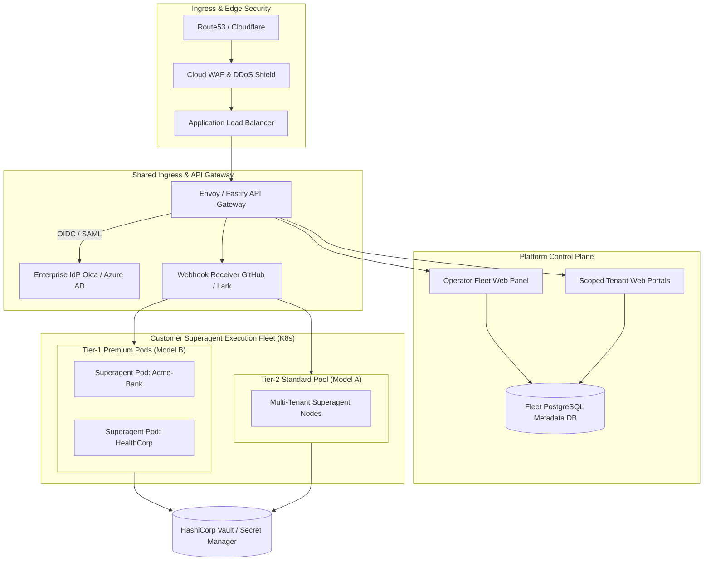
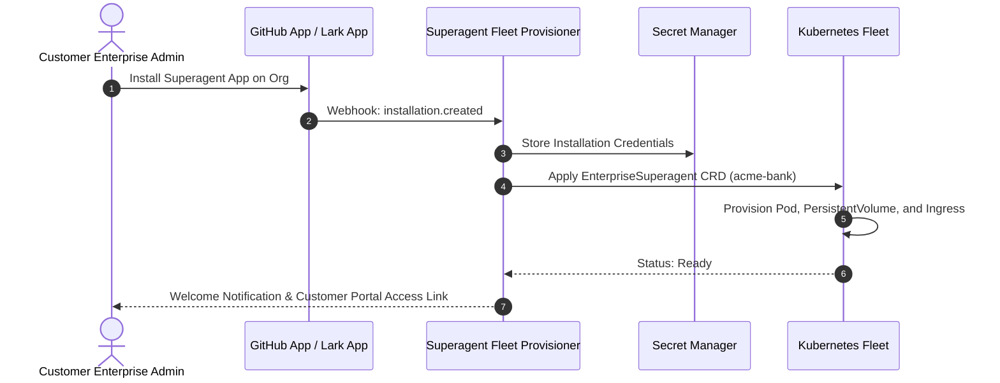

# 04. Enterprise Deployment & Operations Guide

This document provides the production infrastructure, deployment patterns, and Site Reliability Engineering (SRE) runbooks for running **dsh-superagent** across hundreds of enterprise customers. It builds upon [006 Deployment](../docs/006-deployment.md) and [01. Enterprise Tenancy Models](01-enterprise-tenancy-models.md).

---

## 1. Production Architecture Overview

To achieve enterprise reliability and security, dsh-superagent moves from local workstation execution (`scripts/dsh-superagent`) to an orchestrated container infrastructure:



---

## 2. Infrastructure & Orchestration Strategy

### 2.1 Kubernetes Workload Topology
In production, each enterprise superagent instance is managed via a Custom Resource Definition (CRD) or Helm chart:

```yaml
apiVersion: superagent.enterprise/v1alpha1
kind: EnterpriseSuperagent
metadata:
  name: acme-bank
  namespace: tenant-acme-bank
spec:
  tier: "premium" # Model B: Dedicated
  replicas: 1
  resources:
    limits:
      cpu: "4000m"
      memory: "8Gi"
    requests:
      cpu: "1000m"
      memory: "2Gi"
  storage:
    stateDirSize: "50Gi"
    storageClassName: "gp3-encrypted"
  integrations:
    github:
      appId: "123456"
      installationId: "98765432"
      repositories:
        - "acme-bank/core-banking"
        - "acme-bank/payment-gateway"
    modelProvider:
      byokSecretRef: "acme-azure-openai-key"
      endpoint: "https://acme-bank.openai.azure.com/"
  workerSandbox:
    runtimeClass: "gvisor" # Kernel isolation for worker shell jobs
    concurrency: 4
```

### 2.2 Container Sandboxing (gVisor / Kata Containers)
In single-team mode, worker sessions execute as the host OS user (`docs/006-deployment.md`). In enterprise multi-customer production:
- Worker pods or processes run using **gVisor (`runsc`)** or **Kata Containers (microVMs)**.
- System calls are intercepted in user space, completely mitigating the risk of container escape or kernel compromise during arbitrary code compilation (`prepare` commands or test runs).

---

## 3. Database & State Strategy

dsh-superagent stores relational state in SQLite and file blobs in `<stateDir>`. When serving hundreds of customers, there are two primary state architectures:

### 3.1 Database-per-Tenant with Continuous Streaming (Recommended for Model B)
- Each customer instance keeps its local SQLite database (`<stateDir>/superagent.db`) for zero-latency, synchronous transactions (`src/core/engine.ts`).
- **Litestream / SQLite Cloud** streams WAL (Write-Ahead Log) changes continuously to encrypted Amazon S3 or Google Cloud Storage buckets.
- **Recovery:** A crashed or rescheduled pod restores its exact database state from S3 in under 2 seconds.

### 3.2 Partitioned PostgreSQL (For Model A / Model C Gateway)
- Replaces SQLite with a centralized PostgreSQL cluster using Row-Level Security (RLS):
  ```sql
  ALTER TABLE tickets ENABLE ROW LEVEL SECURITY;
  CREATE POLICY tenant_isolation_policy ON tickets
    USING (tenant_id = current_setting('app.current_tenant_id'));
  ```

---

## 4. Secret & Credential Management

### 4.1 Transition from Personal User Accounts to GitHub Apps
In single-tenant deployments, `docs/006-deployment.md` requires creating a dedicated GitHub user account (`gh-agent`). For hundreds of enterprise customers, this does not scale:
- **Solution: Multi-Tenant GitHub App.**
  1. The enterprise customer installs your verified GitHub App into their organization.
  2. The platform receives an installation event with an `installation_id`.
  3. The platform generates an ephemeral, short-lived (1-hour) **Installation Access Token (IAT)** on demand, scoped strictly to the customer's repositories.
  4. Worker CLI wrappers dynamically inject the IAT:
     ```bash
     export GITHUB_TOKEN=$(get-installation-token --tenant acme-bank)
     exec gh "$@"
     ```

### 4.2 Centralized Secret Store
- Secrets (Lark App Secrets, GitHub App Private Keys, LLM Provider API Keys) are stored in **HashiCorp Vault**, **AWS Secrets Manager**, or **GCP Secret Manager**.
- Secrets are mounted to pods via CSI Secret Store Drivers as in-memory tmpfs files—never written to persistent disk or git repositories.

---

## 5. Automated Customer Provisioning Pipeline

Onboarding an enterprise customer follows a declarative, automated pipeline:



---

## 6. SRE Operational Runbooks

### Runbook 1: Triaging a Stalled Customer Ticket
1. Open the Fleet Control Plane and search the Ticket ID.
2. If stage is `person / blocked, failed`:
   - Inspect the worker's latest report and tool execution trace.
   - If caused by an ephemeral network glitch or flaky CI, click **Retry Assignment**.
3. If stage is `person / answer`:
   - The agent requires a decision (e.g., database migration confirmation).
   - Notify the customer's authorized team or answer directly on GitHub PR / Feishu thread.

### Runbook 2: Rotating an Expired Credential
1. Update the secret in HashiCorp Vault.
2. Trigger the pod's setup check via management API:
   ```bash
   curl -X POST https://acme-bank.superagent.internal/orchestrator/api/setup/check \
     -H "Authorization: Bearer $OPERATOR_TOKEN"
   ```
3. Verify that `Runtime.ready` resolves and health transitions to `Healthy`.

### Runbook 3: Rolling Fleet Upgrades
1. Run automated schema migrations (backward-compatible).
2. Execute a Kubernetes Rolling Update with `maxUnavailable: 10%`.
3. dsh-superagent's graceful shutdown waits up to 5 minutes for active worker turns to complete before terminating pods (`docs/006-deployment.md`).
4. Any interrupted assignments automatically restart with a recovery note upon pod startup (`engine.assignmentInterrupted`).
