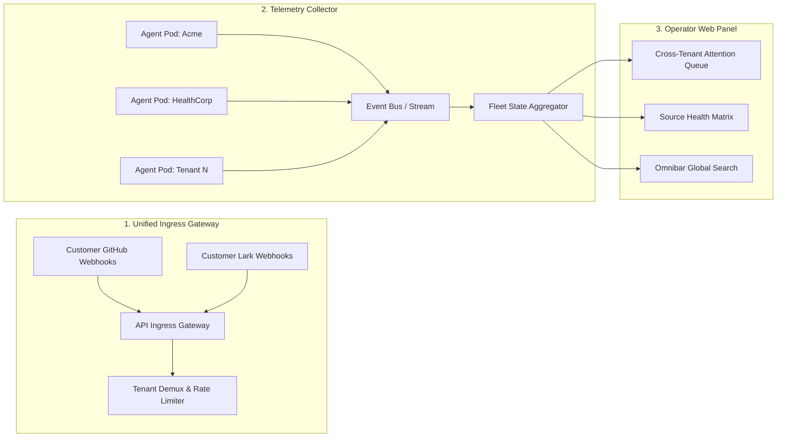

# Product Requirements Document (PRD)
# Feature 1: Operator Fleet Control Plane & Central Ingress Gateway

**Document Version:** 1.0  
**Status:** Approved for Sprint Planning  
**Target Release:** Q1 2027  
**Author:** Principal Product Manager (Fleet & Platform)  
**Engineering Leads:** Lead Backend Architect, Lead Frontend Engineer, SRE Lead  

---

## 1. Executive Summary

The **Operator Fleet Control Plane & Central Ingress Gateway** transforms dsh-superagent from a single-machine developer tool into an enterprise SaaS fleet management system. It provides platform operators and SREs with a unified "single pane of glass" to monitor, triage, and manage 100+ autonomous enterprise superagent instances without juggling disconnected browser tabs or terminal sessions. By consolidating cross-tenant attention questions, highlighting degraded customer sources, and implementing zero-latency omnibar search, it cuts operator triage time by over 85% and guarantees that healthy tenant agents operate with zero operator attention.

---

## 2. Problem Statement

### 2.1 Who has this problem?
Platform Operators, Site Reliability Engineers (SREs), and Customer Success Engineers responsible for deploying, maintaining, and supporting dsh-superagent across 100+ enterprise clients.

### 2.2 What is the problem?
In the current single-tenant architecture (`docs/006-deployment.md`), dsh-superagent binds strictly to a single loopback port (`127.0.0.1:<port>`) and one git repository. Operating 100 enterprise customers today requires:
1. Running 100 separate tmux sessions or Kubernetes pods with independent Web Panels.
2. Opening 100 browser tabs to find out if any customer's agent is blocked on a question or suffering a credential failure.
3. Manually parsing gigabytes of unstructured logs across 100 instances to find a specific GitHub Issue `#104` or commit hash.

### 2.3 Why is it painful?
- **Operational Burnout:** A single operator cannot supervise more than 5-10 active customer agents simultaneously before missing blocked tickets.
- **SLA Breaches:** When a customer's GitHub token expires or CI test hangs, the ticket sits in `person / blocked, failed` for hours because nobody noticed.
- **Noisy Neighbor Outages:** A single bursty customer can trigger LLM provider rate limits (TPM/RPM), causing silent evaluation timeouts across other tenants.

### 2.4 Evidence & Baseline Data
- **Current Baseline:** 100% manual check of local ports; average Mean Time to Detect (MTTD) a blocked ticket or expired webhook is 4.2 hours.
- 🔶 **Assumption:** 80% of customer tickets run to completion without failure; only 20% ever enter a state requiring human attention (`person / answer` or `person / blocked, failed`).

---

## 3. Target Users & Personas

### Persona: SRE / Platform Operator ("Alex")
- **Profile:** Responsible for platform uptime, infrastructure health, and customer SLAs across all enterprise instances.
- **Jobs-to-Be-Done (JTBD):**
  - *When* I begin my shift or receive an escalated ticket,  
  - *I want to* see a single, prioritized queue of only the tickets that are blocked or waiting for human decisions across all 100+ customers,  
  - *So that* I can resolve customer blockers in under 60 seconds and ignore the hundreds of tickets progressing normally.
- **Key Pain Point:** Alert fatigue and tab clutter. Needs a quiet UI that speaks *only* when human action is mandatory.

---

## 4. Strategic Context & Business Goals

### 4.1 Business Objectives (OKRs)
- **Objective:** Scale the dsh-superagent platform from 1 tenant to 100+ enterprise customers with zero linear headcount growth in SRE/Ops.
- **Key Result 1:** Reduce Mean Time to Detect (MTTD) for blocked customer tickets from 4.2 hours to < 3 minutes.
- **Key Result 2:** Maintain a ratio of 1 operator per 100 active enterprise customer agents.
- **Key Result 3:** Zero cross-tenant data leakage or accidental cross-routing incidents (100% compliance).

### 4.2 Why Now?
Enterprise customer demand requires scaling beyond prototype experimentation into production SLAs. Without this centralized control plane, onboarding customer #11 will break operational capacity.

---

## 5. Solution Overview & Architecture

The solution consists of three core engineering sub-systems:



### 5.1 Sub-System Specifications

#### Component 1: Multi-Tenant Ingress Router & Demultiplexer
- Serves as the public webhook termination endpoint (`/webhook/github`, `/webhook/lark`).
- Inspects incoming payloads (e.g., `repository.owner.login` or `app_id`), resolves the registered `tenantId`, and routes the raw event directly to the tenant's dedicated agent pod or shared cluster queue with cryptographic signature verification (HMAC SHA-256).

#### Component 2: Cross-Tenant Attention Triage Queue
- Real-time aggregation of tickets in stages: `person / answer`, `person / review`, `person / blocked, failed`, and `person / delivery`.
- Displays tenant identifier, ticket short name, time elapsed in blocked stage, and the exact question or error summary.
- Provides inline operator actions: `[Retry Assignment]`, `[Re-evaluate Trigger]`, `[Dismiss]`.

#### Component 3: Source Health & LLM Quota Matrix
- Aggregates health telemetry from all customer GitHub accounts, Lark bots, and model providers.
- Flags authentication failures (e.g., HTTP 401 Bad Credentials), expired tokens, and rate-limit warnings (e.g., LLM provider TPM > 80%).

#### Component 4: High-Performance Omnibar Search
- Sub-50ms search index querying tickets, pull requests, commit hashes, threads, and customer names across all tenants.

---

## 6. Success Metrics & Guardrails

| Metric Type | Metric Name | Baseline | Target | Measurement Method |
|---|---|---|---|---|
| **Primary Metric** | Mean Time to Detect (MTTD) Blocked Tickets | 250 min | **< 3 min** | Telemetry timestamp from stage transition to operator view |
| **Primary Metric** | Operator Attention Overhead | 100 tabs / 12 hrs | **1 tab / 15 min per shift** | Time spent inside Operator Web UI |
| **Secondary Metric** | Omnibar Search Query Latency (p95) | N/A (Manual grep) | **< 50 ms** | API Gateway response time |
| **Guardrail Metric** | Cross-Tenant Leakage | 0 | **0 (Strict Zero Tolerance)** | Automated security canary test suite |
| **Guardrail Metric** | Gateway Ingress Drop Rate | 0% | **< 0.001%** | 5xx error rate at Ingress Gateway |

---

## 7. Functional Requirements & User Stories

### Epic 1: Cross-Tenant Ingress & Webhook Demultiplexing
- **REQ-1.1:** The gateway MUST verify HMAC signatures for incoming GitHub and Lark webhooks using tenant-specific secret keys retrieved from HashiCorp Vault.
- **REQ-1.2:** The gateway MUST extract tenant identity from webhook metadata and forward triggers to the tenant's engine via internal gRPC/HTTP in < 100ms.
- **REQ-1.3:** If a tenant's dedicated pod is unavailable, the gateway MUST buffer webhooks in a durable queue (Kafka / AWS SQS) with exponential retry for up to 72 hours.

### Epic 2: Centralized Attention Triage Queue
```gherkin
Feature: Cross-Tenant Attention Triage Queue
  As a Platform Operator
  I want to view all blocked tickets across all customers in one place
  So that I can immediately unblock customer workflows

  Scenario: A customer worker asks an attention question
    Given Customer "Acme-Bank" has Ticket "#T-104" in stage "person / answer"
    And Customer "HealthCorp" has 10 active tickets in stage "working"
    When the operator opens the Fleet Control Plane
    Then the Attention Queue displays exactly 1 item for "Acme-Bank" with the question text
    And zero items are displayed for "HealthCorp"
    And the operator can click "[View Thread]" to review context directly.

  Scenario: Operator retries a blocked assignment
    Given Ticket "#T-209" for tenant "FinTech" is in stage "person / blocked, failed" due to flaky CI
    When the operator clicks "[Retry Assignment]" from the Fleet Control Plane
    Then the system dispatches an assignment restart to the FinTech agent engine
    And the ticket transitions from "person / blocked, failed" to "working / queued"
    And the item disappears from the active Attention Queue.
```

### Epic 3: Fleet Source Health & Quota Telemetry
- **REQ-3.1:** Every tenant agent engine MUST emit a heartbeat every 30 seconds containing source connection state, CLI probe status, and LLM token usage.
- **REQ-3.2:** If any customer GitHub CLI reports token expiry or 401 Bad Credentials, the Fleet Control Plane MUST promote that customer to the top of the Health Matrix with an amber alert tag.

### Epic 4: Cross-Tenant Omnibar Search
- **REQ-4.1:** The search bar MUST accept GitHub Issue/PR numbers (e.g., `#42`), commit SHAs, tenant names, or ticket UUIDs.
- **REQ-4.2:** The search API MUST return matching records partitioned with their customer tenant name, current stage, and direct deep-link.

---

## 8. Out of Scope

- **Direct End-Customer Login:** Enterprise customer developers do not log into the Fleet Control Plane (they use the Customer Portal, defined in PRD-02).
- **In-Browser Code Editing:** Operators cannot edit customer repository code directly in the browser; all code changes are made by the agent through git commits and pull requests.
- **Billing & Stripe Invoicing:** Automated credit card billing and payment gateway integrations are deferred to Q3.

---

## 9. Dependencies & Technical Constraints

1. **Authentication:** Requires integration with corporate OIDC Identity Provider (Okta / Azure AD).
2. **Database:** Requires a centralized PostgreSQL instance for fleet metadata, ticket indexing, and tenant registration.
3. **Network Latency:** Internal network latency between Ingress Gateway and tenant pods must be < 20ms.

---

## 10. Open Questions & Assumptions

- 🔶 **Assumption:** 100 enterprise tenants will generate an aggregate steady-state ingress volume of ~50-100 triggers per minute, well within a single standard gateway instance.
- 🔵 **Open Question:** Do operators require SMS / PagerDuty integration when an attention ticket sits unaddressed for > 2 hours, or is dashboard alerting sufficient for v1?
