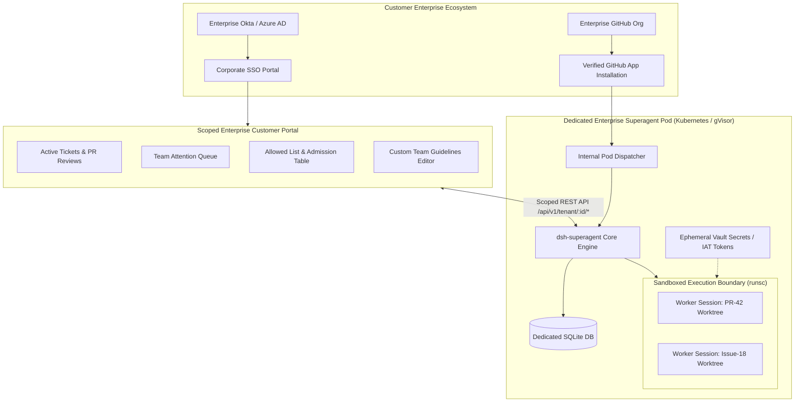

# Product Requirements Document (PRD)
# Feature 2: Dedicated Enterprise Superagent & Scoped Customer Portal

**Document Version:** 1.0  
**Status:** Approved for Sprint Planning  
**Target Release:** Q1 2027  
**Author:** Principal Product Manager (Enterprise Experience & Security)  
**Engineering Leads:** Lead Security Architect, Lead Agent Runtime Engineer, Frontend Lead  

---

## 1. Executive Summary

The **Dedicated Enterprise Superagent & Scoped Customer Portal** delivers an autonomous, compliance-hardened AI software engineering colleague tailored for Tier-1 enterprise organizations. Each enterprise customer receives a fully isolated agent runtime operating within a dedicated gVisor-sandboxed pod with isolated SQLite storage, tenant-specific HashiCorp Vault secrets, and Bring-Your-Own-Key (BYOK) model provider integration. Paired with a scoped, SSO-authenticated self-service Customer Portal, enterprise development teams can supervise pull requests, resolve agent questions, configure team allowed lists, and enforce custom prompt guidelines with zero cross-tenant contamination.

---

## 2. Problem Statement

### 2.1 Who has this problem?
Enterprise Chief Information Security Officers (CISOs), VPs of Engineering, and Software Developers at large enterprise client organizations (e.g., banking, healthcare, regulated tech).

### 2.2 What is the problem?
Large enterprise customers cannot adopt shared multi-tenant AI agents running with host OS privileges due to:
1. **Severe Security & Compliance Risk:** Running customer-authored shell scripts or compilation tools in a shared OS user environment (`docs/006-deployment.md`) fails SOC 2 Type II, ISO 27001, and HIPAA audits.
2. **Lack of Model Quota Control (BYOK):** Enterprises require that AI inference traffic routes through their private Azure OpenAI / Vertex AI / AWS Bedrock contracts to satisfy data residency and zero-data-retention (ZDR) guarantees.
3. **Absence of Customer Self-Service:** Customer engineering managers cannot self-manage their allowed developer lists, team prompt instructions, or branch protection rules without filing manual support tickets to the platform operator.

### 2.3 Why is it painful?
- **Enterprise Deal Blockers:** Enterprise prospects terminate procurement during security review if code or credentials could theoretically leak to neighboring tenants.
- **Uncontrolled Token Costs:** Without BYOK or tenant-level budgeting, platform operators must mark up LLM tokens and absorb financial liability for rogue infinite reasoning loops.

### 2.4 Evidence & Baseline Data
- **Procurement Friction:** 100% of regulated enterprise prospects require verifiable hardware/kernel isolation before granting read/write access to proprietary codebases.
- 🔶 **Assumption:** Premium enterprise customers are willing to pay a 3x-5x subscription premium for a dedicated pod with BYOK model quotas compared to a shared pool.

---

## 3. Target Users & Personas

### Persona 1: Enterprise Engineering Lead ("Elena")
- **Profile:** Manages a team of 30 engineers in a regulated enterprise; wants the agent to handle routine refactoring, PR reviews, and CI fixes.
- **Jobs-to-Be-Done (JTBD):**
  - *When* my developers mention `@superagent` on a GitHub Issue or PR,  
  - *I want* the agent to execute inside an isolated sandbox using our team's coding guidelines and private Azure OpenAI quota,  
  - *So that* we increase sprint velocity without risking code leakage or unexpected cloud bills.

### Persona 2: Enterprise Security Administrator ("Marcus")
- **Profile:** Responsible for organizational data protection, OAuth app governance, and audit trails.
- **Jobs-to-Be-Done (JTBD):**
  - *When* granting repository access to the superagent,  
  - *I want* authentication managed via our scoped GitHub App and corporate SSO (Okta), with all worker jobs isolated by user-space kernel boundaries,  
  - *So that* we satisfy strict SOC 2 audit requirements.

---

## 4. Strategic Context & Business Goals

### 4.1 Business Objectives (OKRs)
- **Objective:** Establish dsh-superagent as the premier high-trust enterprise AI software engineer for regulated industries.
- **Key Result 1:** Achieve 100% pass rate on enterprise vendor security assessments (SOC 2, ISO 27001).
- **Key Result 2:** Onboard 20 Tier-1 enterprise clients with zero reported cross-tenant data or memory incidents.
- **Key Result 3:** 95% of customer administration tasks (allowed list updates, prompt edits, PR reviews) performed via self-service Customer Portal without operator tickets.

---

## 5. Solution Overview & Technical Architecture



### 5.1 Sub-System Specifications

#### Component 1: Dedicated Container / Pod Runtime (Model B)
- Packaged as a declarative Kubernetes Pod using **gVisor (`runsc`)** or **Kata Containers**.
- Worker shell execution (`prepare` scripts, compilers, test runners) occurs in a virtualized user-space kernel, preventing container escapes or host filesystem access.
- Local high-speed SQLite database (`<stateDir>/superagent.db`) backed by **Litestream** continuous streaming to customer-specific encrypted S3 buckets.

#### Component 2: Multi-Tenant GitHub App Integration
- Replaces individual human `gh-agent` accounts with an enterprise **GitHub App**.
- Generates ephemeral, short-lived (1-hour) **Installation Access Tokens (IAT)** scoped strictly to the customer's selected repositories.
- Custom CLI shims automatically inject the IAT into all worker `gh` invocations.

#### Component 3: Bring-Your-Own-Key (BYOK) Model Integration
- Allows enterprise customers to enter their private endpoint (e.g., Azure OpenAI deployment URL) and API key.
- Validates model connectivity, context length, and rate limits upon configuration save.
- All orchestrator evals and worker reasoning loops consume only the customer's BYOK endpoint.

#### Component 4: Scoped Enterprise Customer Portal
- Fast, responsive React/TypeScript Web Portal branded with customer name and corporate logo.
- Authenticated via SAML 2.0 / OIDC through customer's corporate Identity Provider.
- Strictly scoped to the authenticated customer's data (`WHERE tenant_id = :current_tenant`).

---

## 6. Success Metrics & Guardrails

| Metric Type | Metric Name | Baseline | Target | Measurement Method |
|---|---|---|---|---|
| **Primary Metric** | Enterprise Security Assessment Pass Rate | 0% (Failed) | **100%** | Third-party penetration testing & audit |
| **Primary Metric** | Self-Service Management Rate | 0% (Operator edits) | **> 95%** | Customer Portal mutation API events |
| **Secondary Metric** | Dedicated Pod Cold Recovery Time | N/A (Manual setup) | **< 3 seconds** | Litestream WAL restore to readiness |
| **Guardrail Metric** | Cross-Tenant Memory / Disk Breach | 0 | **0 (Zero Tolerance)** | Kernel sandbox isolation tests |
| **Guardrail Metric** | BYOK Credential Leakage | 0 | **0 (Zero Tolerance)** | Automated secret scanner in CI/CD |

---

## 7. Functional Requirements & User Stories

### Epic 1: Containerized gVisor Sandboxing
- **REQ-1.1:** Worker shell commands MUST execute within a gVisor (`runsc`) sandbox that denies access to the host kernel, host `/proc`, and host network devices.
- **REQ-1.2:** Each ticket directory MUST be mounted as a private tmpfs or isolated sub-volume destroyed upon ticket completion (`followsDone`).

### Epic 2: GitHub App IAT Token Management
```gherkin
Feature: Scoped GitHub App Token Generation
  As a Worker Session
  I want to invoke GitHub CLI commands using short-lived credentials
  So that I never possess long-lived personal access tokens

  Scenario: Worker invokes git push on a PR branch
    Given Ticket "#T-501" is executing for customer "Acme-Bank"
    When the worker executes "gh pr create" or "git push origin head"
    Then the credential shim requests an Installation Access Token for "Acme-Bank"
    And the token is verified to expire within 60 minutes
    And the token has zero permissions on any other customer repository.
```

### Epic 3: Scoped Customer Web Portal
```gherkin
Feature: Enterprise Customer Portal Access Control
  As an Enterprise Engineering Lead
  I want to log in via Okta and manage my team's superagent
  So that I have full autonomy over team settings

  Scenario: Customer admin modifies team allowed list
    Given User "Elena" logs in with valid Okta JWT for tenant "Acme-Bank"
    When Elena navigates to "Team Permissions" and adds "@charlie-dev" to the allowed list
    Then the policy gate for "Acme-Bank" updates its allowed list in memory
    And the policy version is incremented
    And no other tenant's allowed list or policy is affected.

  Scenario: Customer attempts to inspect another tenant
    Given User "Elena" from tenant "Acme-Bank"
    When Elena issues a direct API call to "/api/v1/tenants/HealthCorp/tickets"
    Then the API Gateway returns HTTP 403 Forbidden
    And a security audit log event is recorded with alert severity.
```

### Epic 4: Bring-Your-Own-Key (BYOK) Model Configuration
- **REQ-4.1:** The portal MUST provide a BYOK configuration screen accepting Azure OpenAI / Vertex AI endpoints, API keys, and deployment names.
- **REQ-4.2:** The API key MUST be encrypted using AES-256-GCM and stored in HashiCorp Vault. The plain key MUST NEVER be returned to the browser or logged in plaintext.

---

## 8. Out of Scope

- **Direct GitHub Enterprise Server (On-Prem GHES) Support:** Version 1 supports GitHub Cloud (`github.com`) only; on-premise GHES air-gapped appliances are deferred to v2.
- **Custom Model Fine-Tuning:** The platform orchestrates base foundational models; training or fine-tuning custom customer models is out of scope.

---

## 9. Dependencies & Technical Constraints

1. **Kubernetes Infrastructure:** Requires a Kubernetes cluster (EKS, GKE, or AKS) supporting gVisor RuntimeClass.
2. **Key Management:** Requires HashiCorp Vault or AWS KMS for envelope encryption of customer credentials.
3. **Storage:** Requires S3-compatible object storage with versioning and object lock for Litestream WAL backups.

---

## 10. Open Questions & Assumptions

- 🔶 **Assumption:** Enterprise customers will prefer OAuth GitHub App installation over manual personal access tokens in 100% of engagements.
- 🔵 **Open Question:** Should the Customer Portal allow custom CSS/theming to match the enterprise client's internal developer portal branding in v1?
