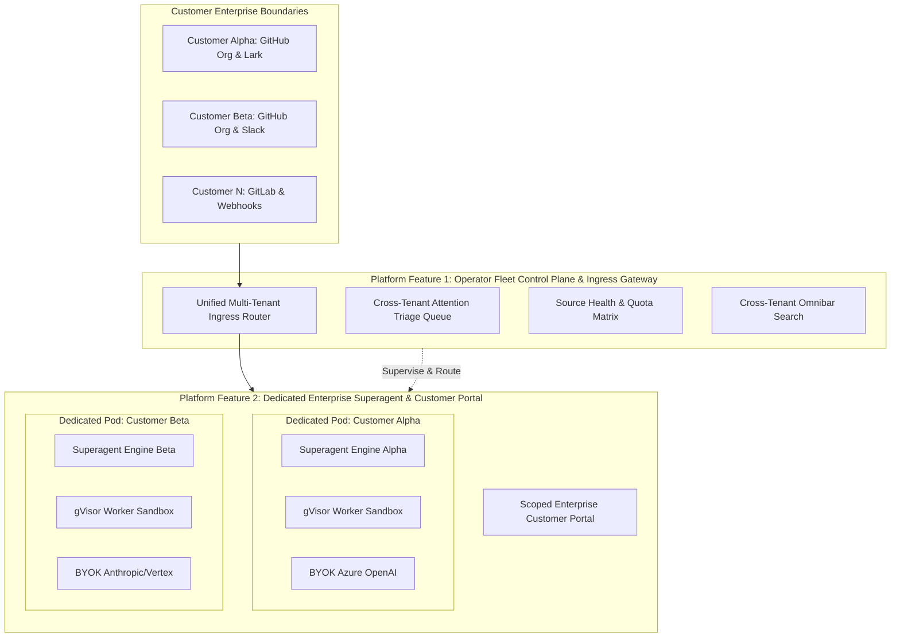

# Enterprise Superagent: Product Requirements Portfolio (`prd/`)

## 1. Document Control & Portfolio Index

This directory (`prd/`) contains the complete, engineering-ready **Product Requirements Document (PRD) Portfolio** for transforming **dsh-superagent** into an enterprise multi-customer platform serving 100+ organizations. 

Crafted using the methodology from [`deanpeters/product-manager-skills`](https://github.com/deanpeters/product-manager-skills) (incorporating `prd-development`, `epic-breakdown-advisor`, `user-story`, and `agent-orchestration-advisor`), these documents bridge technical architectural specifications (`doc-x/`) with actionable execution backlog for the development team.

| Document | Focus & Scope | Primary Stakeholders | Status |
|---|---|---|---|
| [**`01. PRD: Operator Fleet Control Plane`**](01-platform-feature-operator-fleet-control-plane.md) | **Feature 1:** The unified multi-tenant control plane, cross-tenant attention triage queue, source health matrix, and centralized ingress routing ("Make My Job Easy"). | SRE, Platform Eng, DevOps | Ready for Sprint Planning |
| [**`02. PRD: Dedicated Enterprise Superagent & Portal`**](02-platform-feature-dedicated-enterprise-superagent.md) | **Feature 2:** The isolated enterprise agent runtime (sandboxed pods/microVMs, BYOK LLM keys, GitHub App integration) + Scoped Customer Web Portal. | Backend Eng, Security, UI Eng | Ready for Sprint Planning |
| [**`03. Engineering Backlog & User Stories`**](03-epics-and-engineering-backlog.md) | Detailed Epics, User Stories with Gherkin acceptance criteria (`Given/When/Then`), INVEST validation, and edge cases. | Dev Team, QA, Scrum Master | Ready for Estimation |
| [**`04. Security, Compliance & NFRs`**](04-compliance-security-nfr.md) | Non-functional requirements: Kernel sandboxing, SOC 2/ISO 27001 isolation, token quota attribution, and concurrency SLAs. | Security Eng, Compliance, Architects | Approved |

---

## 2. Product Vision & Operating Philosophy

### 2.1 The North Star
> **"Deliver autonomous, high-trust software engineering agents to hundreds of enterprise customers while reducing human operator attention to zero for healthy workloads."**

### 2.2 Core Invariants
1. **The Attention Invariant:** If all 100+ enterprise superagents are working normally, the operator UI is silent and empty. The system alerts humans *only* when a deterministic block requires human judgement (`Attention` / `person / answer`).
2. **Deterministic Gating:** Every event must pass deterministic admission (`policy.gate`) before touching an LLM token or worker slot.
3. **Hard Data Isolation:** Enterprise customer code, git credentials, and memory never intermingle on shared OS hosts.
4. **Verifiable Mandates:** Every autonomous code mutation traces back to an immutable, cryptographically verifiable `Mandate`.

---

## 3. The Two Distinct Platform Features

- **Feature 1: Operator Fleet Control Plane ("Make My Job Easy"):** Solves operator burnout. Provides one single pane of glass to supervise 100+ customer agents, detect blocked tickets, rotate expired credentials, and prevent noisy-neighbor quota exhaustion.
- **Feature 2: Dedicated Enterprise Superagent & Customer Portal:** Solves enterprise compliance and autonomy. Provides enterprise customers with their own dedicated, sandboxed AI agent with BYOK model quotas, coupled with a branded, SSO-authenticated self-service portal to manage allowed lists and review PRs.
